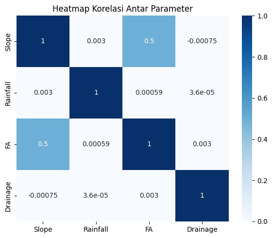

# Eksplorasi Data Kerentanan Banjir Pluvial (Python)

Eksplorasi 144.401 titik data kerentanan banjir pluvial dengan GeoPandas: statistik deskriptif, distribusi parameter, korelasi antar parameter, dan peta interaktif titik berkerentanan tinggi.

Tugas 4 bootcamp WebGIS Developer (Python Basic).



*Heatmap korelasi dari output sebelum pembersihan NoData; akan diperbarui setelah notebook dijalankan ulang.*

## Langkah

1. Memuat GeoJSON titik dengan GeoPandas.
2. Membersihkan nilai NoData raster (`-3.4e38`) menjadi `NaN`.
3. Statistik deskriptif dan histogram Slope, Rainfall, dan TWI.
4. Distribusi kelas kerentanan (`SUSCEP`).
5. Scatter plot hubungan Slope, Rainfall, TWI, Flow Accumulation, dan Drainage.
6. Heatmap korelasi antar parameter.
7. Peta interaktif Folium untuk titik kelas `HIGH` dan `VERY_HIGH`.

## Menjalankan

```bash
pip install geopandas folium matplotlib seaborn
```

Letakkan `data_point_pluvial_flood_dataset.geojson` (data bootcamp, tidak disertakan karena ukurannya) di folder `data/`, lalu jalankan `Task Day 4.ipynb`.

## Catatan perbaikan

Notebook sudah ditambah langkah pembersihan NoData (bagian 3.1). Sebelumnya nilai `-3.4e38` ikut dihitung, sehingga rata-rata dan histogram TWI serta Slope tidak bermakna. **Output yang tersimpan masih dari versi lama.** Jalankan ulang notebook dengan datanya untuk memperbarui grafik.

## Tools

Python · GeoPandas · pandas · Matplotlib · Seaborn · Folium

## Penulis

**Arsya Dika** · [GitHub](https://github.com/ArsyaDika)
