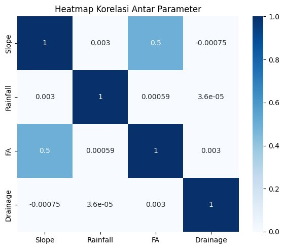

# Exploring Pluvial Flood Susceptibility Data (Python)

Before you can map risk, you have to trust the numbers. In this notebook I worked through 144,401 pluvial flood susceptibility points with GeoPandas, cleaned the data, tested how the parameters relate to each other, and **mapped where susceptibility is highest**.

Task 4 of the WebGIS Developer bootcamp (Python Basic).



*Correlation heatmap from the output before NoData cleaning; it will be updated once the notebook is rerun.*

## Steps

1. Load the point GeoJSON with GeoPandas.
2. Clean the raster NoData values (`-3.4e38`) into `NaN`.
3. Descriptive statistics and histograms for Slope, Rainfall and TWI.
4. Distribution of the susceptibility classes (`SUSCEP`).
5. Scatter plots of the relationships between Slope, Rainfall, TWI, Flow Accumulation and Drainage.
6. Correlation heatmap across the parameters.
7. Interactive Folium map for points of class `HIGH` and `VERY_HIGH`.

## Running

```bash
pip install geopandas folium matplotlib seaborn
```

Place `data_point_pluvial_flood_dataset.geojson` (bootcamp data, not included because of its size) in the `data/` folder, then run `Task Day 4.ipynb`.

## Notes on fixes

The notebook now includes a NoData cleaning step (section 3.1). Previously the `-3.4e38` values were counted, so the means and the TWI and Slope histograms were meaningless. **The saved outputs are still from the old version.** Rerun the notebook with the data to refresh the charts.

## Tools

Python · GeoPandas · pandas · Matplotlib · Seaborn · Folium

## Author

**Arsya Dika** · [GitHub](https://github.com/ArsyaDika)

------------------

# Eksplorasi Data Kerentanan Banjir Pluvial (Python)

Eksplorasi 144.401 titik data kerentanan banjir pluvial dengan GeoPandas: statistik deskriptif, distribusi parameter, korelasi antar parameter, dan peta interaktif titik berkerentanan tinggi.

Tugas 4 bootcamp WebGIS Developer (Python Basic).


*Heatmap korelasi dari output sebelum pembersihan NoData; akan diperbarui setelah notebook dijalankan ulang.*

## Langkah

1. Memuat GeoJSON titik dengan GeoPandas.
2. Membersihkan nilai NoData raster (`-3.4e38`) menjadi `NaN`.
3. Statistik deskriptif dan histogram Slope, Rainfall, dan TWI.
4. Distribusi kelas kerentanan (`SUSCEP`).
5. Scatter plot hubungan Slope, Rainfall, TWI, Flow Accumulation, dan Drainage.
6. Heatmap korelasi antar parameter.
7. Peta interaktif Folium untuk titik kelas `HIGH` dan `VERY_HIGH`.

## Menjalankan

```bash
pip install geopandas folium matplotlib seaborn
```

Letakkan `data_point_pluvial_flood_dataset.geojson` (data bootcamp, tidak disertakan karena ukurannya) di folder `data/`, lalu jalankan `Task Day 4.ipynb`.

## Catatan perbaikan

Notebook sudah ditambah langkah pembersihan NoData (bagian 3.1). Sebelumnya nilai `-3.4e38` ikut dihitung, sehingga rata-rata dan histogram TWI serta Slope tidak bermakna. **Output yang tersimpan masih dari versi lama.** Jalankan ulang notebook dengan datanya untuk memperbarui grafik.

## Tools

Python · GeoPandas · pandas · Matplotlib · Seaborn · Folium

## Penulis

**Arsya Dika** · [GitHub](https://github.com/ArsyaDika)
